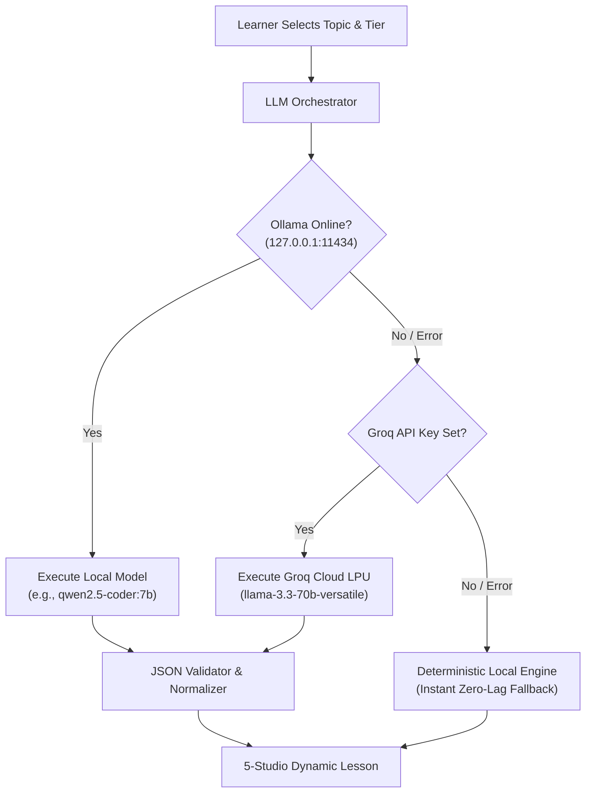

# CogFlow Engine — Developer & Learner Onboarding Guide

> **CogFlow** is a cognitive-aware, adaptive intelligence learning platform engineered with multi-tier pedagogical depth (Foundations $\rightarrow$ Core Standard $\rightarrow$ Advanced Rigor). It features 5 specialized learning studios, on-device telemetry with a 30-second sustained adaptation invariant, 3 viewing formats (Light, Comfort, Dark), and a resilient multi-tier AI pipeline powered by **Ollama**, **Groq Cloud**, and an offline **Deterministic Engine**.

---

## Table of Contents
1. [Prerequisites](#1-prerequisites)
2. [5-Minute Quickstart](#2-5-minute-quickstart)
3. [AI Engine Architecture & Ollama Setup](#3-ai-engine-architecture--ollama-setup)
   - [Why Ollama?](#why-ollama)
   - [Installing Ollama](#installing-ollama)
   - [Pulling Recommended Models](#pulling-recommended-models)
   - [Starting the Ollama Service](#starting-the-ollama-service)
   - [CORS Configuration](#cors-configuration)
4. [Cloud Acceleration: Groq LPU Fallback](#4-cloud-acceleration-groq-lpu-fallback)
5. [Deterministic Offline Engine (Zero Blank States)](#5-deterministic-offline-engine-zero-blank-states)
6. [The 5 Specialized Studios](#6-the-5-specialized-studios)
7. [The 3 Visual Theme Formats](#7-the-3-visual-theme-formats)
8. [The 30-Second Sustained Adaptation Invariant](#8-the-30-second-sustained-adaptation-invariant)
9. [Available CLI Scripts](#9-available-cli-scripts)
10. [Troubleshooting & Common Questions](#10-troubleshooting--common-questions)

---

## 1. Prerequisites

Before running CogFlow, ensure your environment has the following installed:

| Tool | Version Requirement | Purpose |
| :--- | :--- | :--- |
| **Node.js** | `v18.0.0+` (v20+ or v22+ recommended) | JavaScript runtime for both client and backend server |
| **npm** | `v9.0.0+` | Monorepo workspace package manager |
| **Git** | Any modern version | Repository version control |
| **Ollama** *(Optional but recommended)* | `v0.3.0+` | Local, private on-device LLM generation |
| **MongoDB** *(Optional)* | `v6.0+` | Database (CogFlow features an **automatic in-memory fallback** if MongoDB is absent) |

---

## 2. 5-Minute Quickstart

### Step 1: Clone the Repository
```bash
git clone https://github.com/Maayank18/CogFlow-Engine.git
cd "CogFlow - Engine"
```

### Step 2: Install Workspace Dependencies
CogFlow is structured as an `npm` workspace monorepo (`shared`, `server`, and `client`). Install all dependencies with a single command from the root directory:
```bash
npm install
```

### Step 3: Run the Full-Stack Platform
Launch both the backend API server and the Vite React frontend concurrently:
```bash
npm run dev
```

The terminal will launch:
- **Client Frontend**: [http://localhost:5173](http://localhost:5173)
- **Backend API Server**: [http://localhost:8000](http://localhost:8000)
- **API Health Check**: [http://localhost:8000/api/v1/health](http://localhost:8000/api/v1/health)

Open [http://localhost:5173](http://localhost:5173) in your browser to start learning immediately!

> [!NOTE]
> If MongoDB is not running locally on port `27017`, CogFlow will automatically boot its built-in in-memory resilience store. No manual database setup is required to run and test the application.

---

## 3. AI Engine Architecture & Ollama Setup

CogFlow features an intelligent, multi-layer fallback orchestrator designed to ensure that lesson materials and conceptual assessments are always generated with zero downtime:



### Why Ollama?
- **100% On-Device Privacy**: Your syllabus, documents, and student interactions remain strictly on your machine.
- **Zero Token Cost**: Run unlimited complex STEM lessons without API billing or rate limits.
- **Offline Capable**: Study anywhere, even during network partitions or on airplanes.

### Installing Ollama
1. Download Ollama for your operating system:
   - **Windows**: Download the installer from [ollama.com/download/windows](https://ollama.com/download/windows).
   - **macOS**: Download from [ollama.com/download/mac](https://ollama.com/download/mac).
   - **Linux**: Run `curl -fsSL https://ollama.com/install.sh | sh`.

2. Verify installation in your terminal:
   ```bash
   ollama --version
   ```

### Pulling Recommended Models
CogFlow is optimized for code, mathematical notation, and structured JSON lesson generation. Pull one of our recommended models:

```bash
# Recommended for STEM, Distributed Systems, and Code (High Quality)
ollama pull qwen2.5-coder:7b

# Balanced General Instruction (Fast)
ollama pull mistral:7b

# Ultra-Lightweight (Ideal for lower RAM / Laptops without dedicated GPU)
ollama pull llama3.2:3b
```

### Starting the Ollama Service
Ensure the Ollama daemon is actively running:
```bash
ollama serve
```
By default, Ollama listens on `http://127.0.0.1:11434`.

### CORS Configuration
If you run Ollama on a different network interface or experience browser origin restrictions, configure `OLLAMA_ORIGINS`:

- **Windows (PowerShell)**:
  ```powershell
  $env:OLLAMA_ORIGINS="*"
  ollama serve
  ```
- **macOS / Linux**:
  ```bash
  OLLAMA_ORIGINS="*" ollama serve
  ```

### Verifying Ollama in CogFlow
1. Open the CogFlow application at [http://localhost:5173](http://localhost:5173).
2. Navigate to **Settings** $\rightarrow$ **AI Provider & Model Diagnostics**.
3. Click **Run Diagnostics**. You will see:
   - **Provider**: `Ollama Local Engine`
   - **Status**: `Connected`
   - **Active Models**: Detected local weights (e.g., `qwen2.5-coder:7b`, `mistral:7b`).

---

## 4. Cloud Acceleration: Groq LPU Fallback

If your computer has limited hardware resources or you want ultra-low latency inference (sub-300ms token generation), connect a **Groq Cloud API Key**:

1. Obtain a free API key at [console.groq.com/keys](https://console.groq.com/keys).
2. You can configure it in either of two ways:
   - **Via GUI**: In CogFlow, open **Settings** $\rightarrow$ **Groq Cloud API Key**, paste your key, and click **Validate & Connect**.
   - **Via Environment Variable**: In `server/.env`, set:
     ```env
     GROQ_API_KEY=gsk_your_actual_key_here
     GROQ_MODEL=llama-3.3-70b-versatile
     ENABLE_CLOUD_FALLBACK=true
     ```
3. Whenever Ollama is offline or uninstalled, CogFlow automatically routes lesson generation through Groq at lightning speed.

---

## 5. Deterministic Offline Engine (Zero Blank States)

CogFlow is built on the engineering invariant that **a learner should never be blocked by a network outage, API timeout, or missing model weight**.

If both Ollama and Groq are unavailable:
- CogFlow's **Deterministic Local Pedagogical Engine** automatically activates.
- It supplies structured, curated curricula across Foundations (Tier B), Core (Tier A), and Advanced (Tier S).
- Every discipline (Computer Science, Artificial Intelligence, Mathematics, Physics, and Systems Engineering) loads instantly with full interactive visual diagrams, runnable code, and assessments.

---

## 6. The 5 Specialized Studios

When you enter any topic in the **Learning Cockpit**, CogFlow provides 5 interactive studios tailored to different cognitive modalities:

| Studio | Features & Capabilities |
| :--- | :--- |
| **1. Learn Studio** | Rigorous concept sections formatted with rich markdown, inline and display LaTeX math ($E=mc^2$), key takeaways, and active comprehension check accordions. |
| **2. Visual Studio** | Interactive architecture diagrams and state transitions rendered via Mermaid and our built-in SVG flow renderer. Includes a multi-step **Phase Inspector** to step through execution. |
| **3. Code Studio** | Runnable, commented reference implementations in TypeScript/Python with computational complexity analysis ($O(N)$ time/space bounds) and edge case breakdowns. |
| **4. Notes Studio** | High-yield revision cards categorized by *Definitions*, *Engineering Pitfalls*, and interactive double-sided *Flashcards* for active recall. |
| **5. Practice Studio** | Multi-question testing with 8–10 MCQs and conceptual rubric challenges per tier. Includes an interactive stepper, instant scoring, answer key reveal, and detailed pedagogical feedback. |

---

## 7. The 3 Visual Theme Formats

CogFlow includes three distinct, professionally engineered visual themes:

1. **Light Mode (Crisp White)**:
   - High-contrast pure white canvas (`#ffffff`) with deep obsidian typography (`#09090b`).
   - Optimal for brightly lit rooms and daylight sessions.
2. **Comfort Mode (Eye-Care Sepia)**:
   - Soothing warm off-white / natural paper tone (`#f7f4ed`) with soft porcelain card surfaces (`#fdfbf7`) and warm espresso text (`#26221f`).
   - Specifically engineered to eliminate harsh blue-light glare and eye fatigue during multi-hour study sessions.
3. **Dark Mode (True OLED Black)**:
   - Pitch-black canvas (`#000000`) with refined zinc obsidian cards (`#09090b`) and high-contrast white text (`#f4f4f5`).
   - Perfect for evening study and minimizing screen emissions.

### How to Toggle Themes
- Click the **Theme Toggle Pill** in the top navigation bar of the application or landing preview to cycle:
  $$\text{Light (Sun)} \longrightarrow \text{Comfort (Eye)} \longrightarrow \text{Dark (Moon)} \longrightarrow \text{Light}$$
- Or select your preferred format directly from **Settings** $\rightarrow$ **Appearance & Theme Formats**.

---

## 8. The 30-Second Sustained Adaptation Invariant

CogFlow protects learners from cognitive thrashing by enforcing a strict **30-second sustained adaptation invariant**:

```
Transient Difficulty Spike (< 30s)  ───> Invariant Holds: Maintain Tier
Sustained Cognitive Overload (> 30s) ───> Propose Scaffolding: Tier A ──> Tier B (Foundations)
Sustained Effortless Flow (> 30s)   ───> Propose Challenge:   Tier A ──> Tier S (Advanced)
```

- **Client-Side Telemetry**: When the optional camera is toggled on, facial telemetry is processed strictly on your local browser using client-side WebAssembly models. **Frames and video streams are never transmitted to any server or cloud API**.
- **Manual Inference Simulator**: Test the invariant at any time using the **Inference Simulation** widget on the right panel of the Learning Cockpit (simulating *Flow*, *Overload (30s)*, *Boredom (30s)*, or *Jitter*).

---

## 9. Available CLI Scripts

Execute these commands from the root directory:

```bash
# Start both server and client concurrently in development mode
npm run dev

# Run server only
npm run dev:server

# Run client only
npm run dev:client

# Execute complete test suite (server + client integration tests)
npm test

# Build production bundles for shared, server, and client
npm run build

# Run TypeScript typechecks across the entire monorepo
npm run typecheck
```

---

## 10. Troubleshooting & Common Questions

### Q: Why do I see "Port 27017 is not listening. Activating CogFlow In-Memory Resilience Store"?
**A**: This is expected behavior if you don't have MongoDB running locally. CogFlow initializes its built-in in-memory document database so you can test, create users, ingest syllabi, and practice assessments with zero database installation.

### Q: Why is my Ollama status showing "Disconnected"?
**A**: Ensure you have launched Ollama by running `ollama serve` in a terminal window. Verify that visiting [http://127.0.0.1:11434](http://127.0.0.1:11434) in your browser displays `Ollama is running`.

### Q: How do I change the default AI model used by Ollama?
**A**: Create or edit `server/.env` and update:
```env
OLLAMA_MODEL=mistral:7b
```
Restart `npm run dev` for the changes to take effect.

### Q: Are my webcam frames saved or uploaded anywhere?
**A**: **Never**. CogFlow implements a strict Privacy Invariant: all cognitive load calculations are performed entirely on-device inside your browser sandbox. No biometrics, frames, or image vectors are ever recorded to disk or sent across the network.

---

*Engineered with precision for calm, focused, adaptive mastery.*
