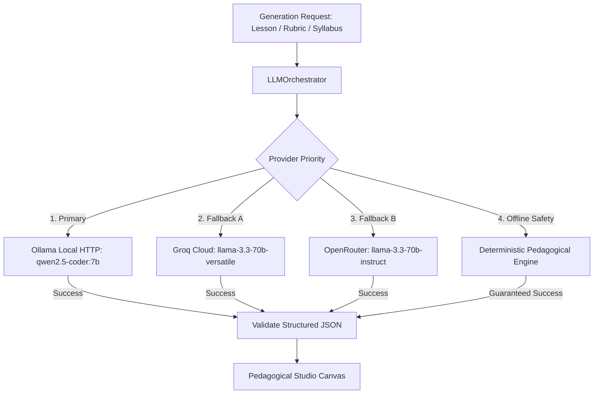

# CogFlow AI Orchestration & Multi-Provider Architecture

CogFlow features an extensible, provider-independent LLM orchestration system that combines **local edge inference** with **cloud failover** and **deterministic fallbacks**.



---

## 1. Provider Implementations

### A. Local Ollama Provider (`OllamaProvider.ts`)
- **Host**: `http://127.0.0.1:11434`
- **Model**: `qwen2.5-coder:7b` (Configurable via `OLLAMA_MODEL`)
- **API Endpoint**: `/api/chat` and `/api/tags`
- **Capabilities**: Local inference, low latency, zero cloud API costs, structured JSON formatting, streaming chunks via NDJSON.
- **Resilience**: Performs lightweight HTTP ping check before dispatching requests. Gracefully yields to fallback when Ollama daemon is offline or model is missing.

### B. Groq Provider (`GroqProvider.ts`)
- **Model**: `llama-3.3-70b-versatile`
- **API**: OpenAI-compatible completions API with streaming.
- **Security**: Server-side API key only; credentials are never sent to the browser.

### C. OpenRouter Provider (`OpenRouterProvider.ts`)
- **Model**: `meta-llama/llama-3.3-70b-instruct`
- **Fallback**: Secondary cloud failover when Groq experiences rate limits or timeouts.

### D. Deterministic Pedagogical Engine (`deterministicFallback.ts`)
- When no local or cloud model is available (e.g. offline aircraft or CI runner), CogFlow activates the built-in deterministic pedagogical engine.
- Generates complete, scientifically accurate B, A, and S tier lessons, Mermaid diagrams, code walkthroughs, flashcards, and rubric evaluations.
- **Zero Broken States**: Ensures the user never encounters blank pages or raw network errors.

---

## 2. Prompt Engineering System

All prompts are centrally managed in `server/src/infrastructure/llm/prompts.ts`:

1. **Multi-Tier Prompt Calibration**:
   - `Tier B (Foundations)`: Enforces concrete everyday analogies, step-by-step visual intuition, and minimal jargon.
   - `Tier A (Core Standard)`: Enforces formal conceptual clarity, architecture diagrams, and production engineering patterns.
   - `Tier S (Advanced Rigor)`: Enforces formal state invariants $\Phi(s)$, asymptotic proofs, lock-free concurrency, and distributed partition failure modes.
2. **Semantic Pedagogical Rubric Grading**:
   - Rather than simple keyword matching, the rubric prompt evaluates causal reasoning, conceptual accuracy, missing boundary conditions, and identified misconceptions.

---

## 3. Streaming Protocol
CogFlow supports real-time token streaming via **NDJSON** (`application/x-ndjson`).
Each stream chunk conforms to:
```json
{ "content": "token ", "isComplete": false, "provider": "ollama" }
```
When stream finishes:
```json
{ "content": "", "isComplete": true, "provider": "ollama" }
```
The frontend consumes chunks incrementally, ensuring fast time-to-first-token (TTFT) even for large lessons.
