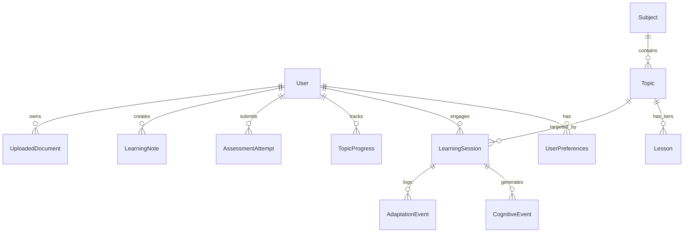

# CogFlow Database Schema & Storage Architecture

CogFlow utilizes **MongoDB with Mongoose schemas**, featuring automatic zero-configuration failover to an in-memory document resilience store when MongoDB is not running locally.

---

## 1. Mongoose Collections & Schema Design

### 1. `User`
- `_id`: ObjectId (Primary key)
- `email`: String (Unique, Indexed, Lowercase)
- `passwordHash`: String (Bcrypt salt rounds 12)
- `name`: String
- `role`: Enum ('learner', 'educator', 'admin')
- `createdAt`, `updatedAt`: Timestamps

### 2. `UserPreferences`
- `userId`: ObjectId (Ref User, Unique Index)
- `theme`: Enum ('light', 'dark', 'system')
- `defaultTier`: Enum ('B', 'A', 'S')
- `preferredMode`: Enum ('learn', 'visualize', 'code', 'notes', 'practice')
- `cameraMonitoringConsent`: Boolean (Default: false)
- `behavioralTelemetryConsent`: Boolean (Default: true)
- `academicLevel`: Enum ('beginner', 'intermediate', 'advanced', 'researcher')
- `primaryInterests`: Array of Strings

### 3. `Subject` & `Topic`
- **Subject**: `slug` (Unique), `title`, `category`, `description`, `icon`, `topicCount`, `order`.
- **Topic**: `subjectId` (Ref Subject), `slug`, `title`, `summary`, `prerequisites`, `learningObjectives`, `estimatedMinutes`, `difficultyBaseline`, `order`.
- *Compound Index*: `{ subjectId: 1, slug: 1 }` (Unique).

### 4. `Lesson`
Stores the multi-tier representations of each topic:
- `topicId`: ObjectId (Ref Topic)
- `tier`: Enum ('B', 'A', 'S')
- `summary`: String
- `learningObjectives`: [String]
- `sections`: Array of ConceptSections (What, How, Misconceptions, Checkpoints)
- `visualDiagram`: Mermaid diagram code & sequential stages
- `codeExample`: Syntax-highlighted code, complexity metadata, edge cases, I/O demo
- `revisionNotes`: Definitions, formulas, pitfalls, and flashcards
- `practiceQuestions`: MCQs and conceptual questions with rubric criteria
- *Compound Index*: `{ topicId: 1, tier: 1 }` (Unique).

### 5. `LearningSession`
- `userId`: ObjectId (Ref User)
- `topicId`: ObjectId (Ref Topic)
- `currentTier`: Enum ('B', 'A', 'S')
- `currentMode`: Enum ('learn', 'visualize', 'code', 'notes', 'practice')
- `activeDurationSeconds`: Number
- `isCompleted`: Boolean
- `startedAt`, `lastActiveAt`, `endedAt`: Dates
- *Index*: `{ userId: 1, isCompleted: 1, lastActiveAt: -1 }`

### 6. `TopicProgress`
- `userId`: ObjectId, `topicId`: ObjectId (Unique Compound Index)
- `masteryLevel`: Number (0-100)
- `highestTierReached`: Enum ('B', 'A', 'S')
- `assessmentCount`: Number
- `averageScore`: Number
- `isMastered`: Boolean (Set when masteryLevel ≥ 80%)

### 7. `AssessmentAttempt`
- `userId`: ObjectId, `assessmentId`: ObjectId, `topicId`: ObjectId
- `tier`: Enum ('B', 'A', 'S')
- `score`, `maximumScore`, `percentage`, `passed`: Numbers & Boolean
- `answers`: Evaluated answers with earned scores and granular feedback
- `strengths`, `missingConcepts`, `misconceptions`, `recommendedRevision`: [String]
- *Index*: `{ userId: 1, topicId: 1, submittedAt: -1 }`

### 8. `UploadedDocument`
- `userId`: ObjectId
- `fileName`, `originalName`, `mimeType`, `fileSizeBytes`: Metadata
- `detectedTopics`: Array of extracted candidate topics with page references
- `chunks`: Page-segmented text chunks for retrieval

### 9. `CognitiveEvent` & `AdaptationEvent`
- **CognitiveEvent**: Stores normalized state labels (`FLOW`, `OVERLOAD`, `BOREDOM`, `UNKNOWN`), confidence, source, and observation timestamp.
  - *Data Retention*: 30-day automatic TTL index (`expireAfterSeconds: 2592000`).
  - *Zero Biometrics*: Video frames are NEVER stored.
- **AdaptationEvent**: Audit record of triggered 30-second invariant adaptations: previous tier, suggested tier, resulting tier, trigger reason, and whether the learner accepted or dismissed.

---

## 2. In-Memory Resilience Fallback Store
When local MongoDB is not running, CogFlow seamlessly initializes an in-memory document store (`server/src/infrastructure/database/inMemoryStore.ts`).
- Provides identical query syntax (`find`, `findOne`, `findById`, `create`, `findByIdAndUpdate`, `deleteOne`).
- Enables immediate testing, offline CI/CD, and fast developer onboarding with zero prerequisites.
